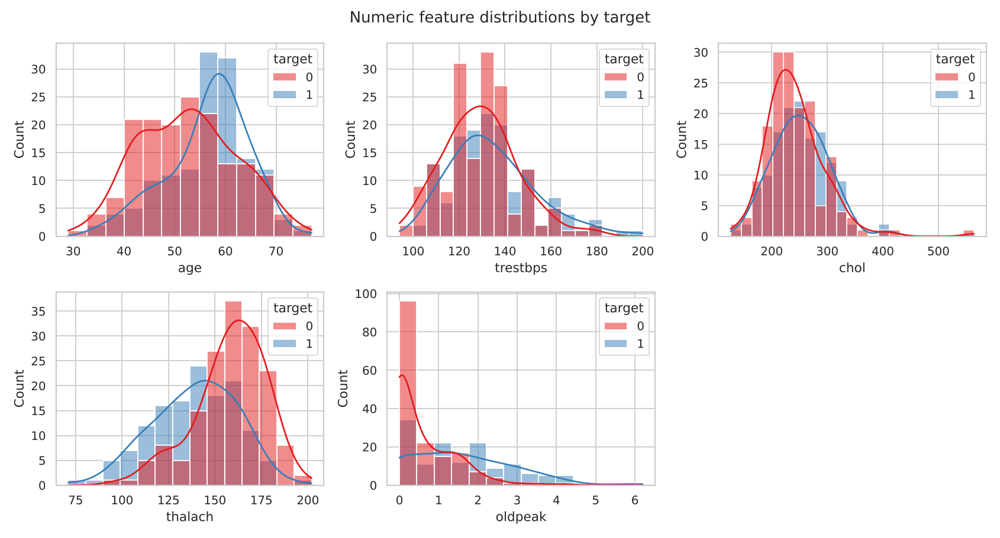
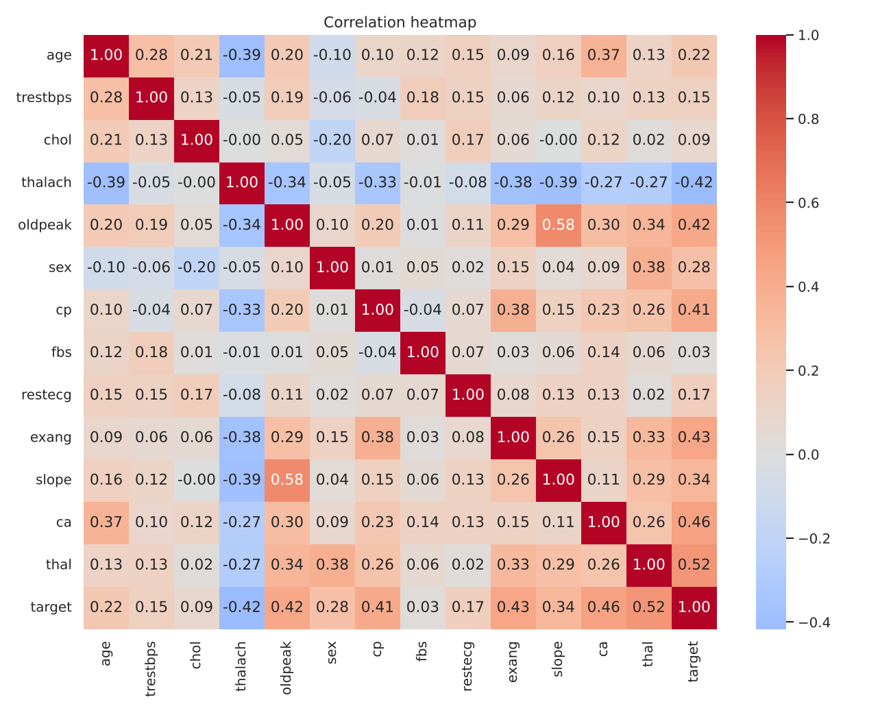
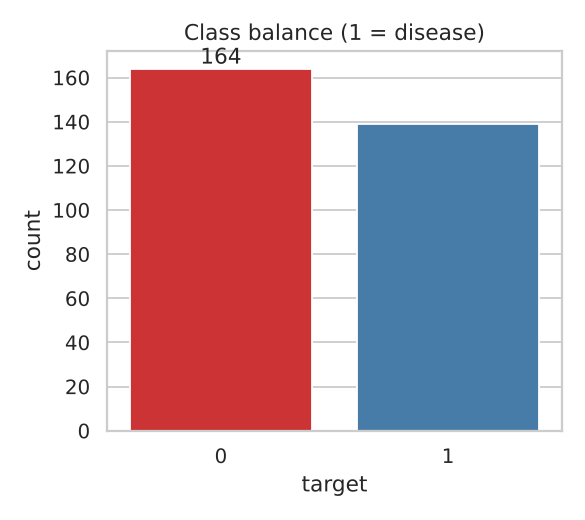
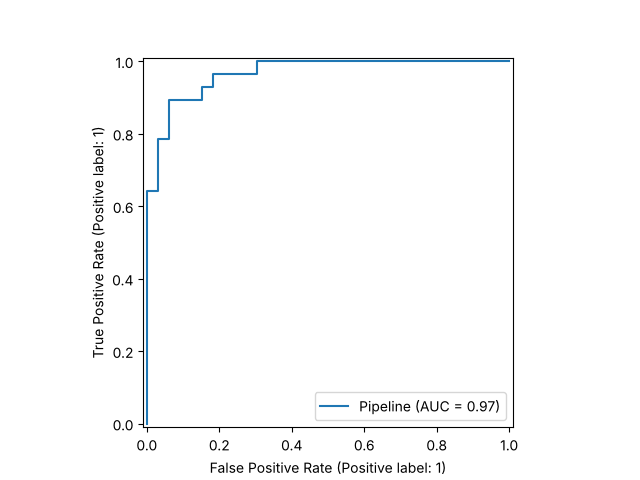
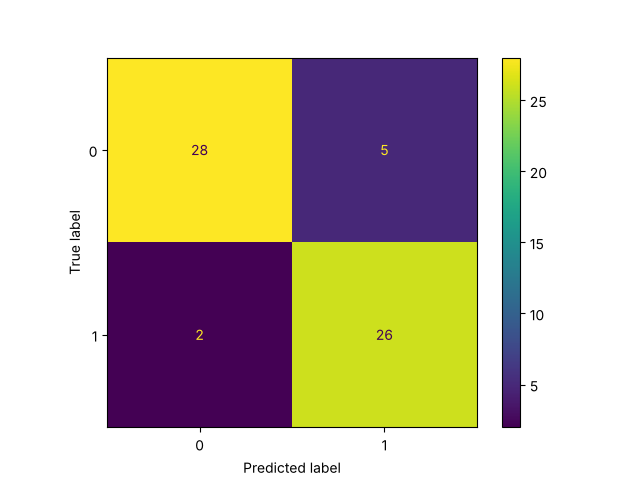
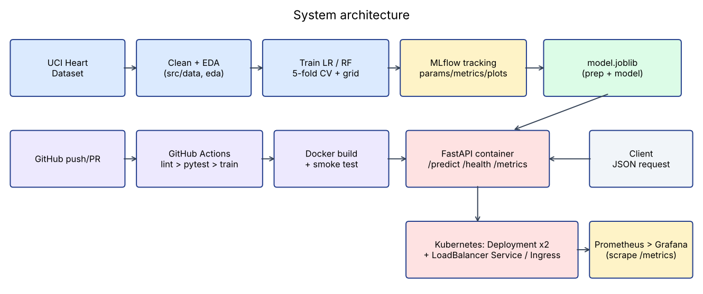

**Course:** MLOps (AIMLCZG523), BITS Pilani WILP  **Student:** Utsav  **Repo:** `<GITHUB_REPO_URL>`  **API:** `<DEPLOYED_URL or http://localhost via minikube tunnel>`

## 1. Problem and Dataset
Binary classifier predicting presence of heart disease from 13 clinical features (Cleveland subset of the UCI Heart Disease dataset, `processed.cleveland.data`, 303 rows). The original target (0 to 4) is binarised: 0 = absent, 1 = present (any value above 0). Raw data is obtained by `scripts/download_data.py` (downloads from UCI, or parses a local copy: `python scripts/download_data.py <path>`) and cleaned by `src/data.py` into `data/heart_clean.csv`.

## 2. Setup / Installation
```bash
python -m venv .venv && source .venv/bin/activate
pip install -r requirements.txt
python scripts/download_data.py && python -m src.eda && python -m src.train
pytest -v && flake8 src tests scripts
uvicorn src.api:app --port 8000
```
All scripts run from a clean environment using `requirements.txt`. Full Docker, Kubernetes and monitoring commands are in `README.md`.

## 3. Data Cleaning and EDA
**Cleaning:** the file marks missing values with `?`; these are read as NaN. There are 6 missing values (`ca`: 4, `thal`: 2) and no duplicate rows. Numerics are imputed with the median and categoricals with the mode, required columns are validated, and the target is binarised. 303 rows remain.

**Findings** (figures: `screenshots/eda_*.png`):

{width=90%}

{width=70%}

{width=40%}

- Classes are near balanced (164 absent / 139 present, 45.9% positive), so accuracy is meaningful and no resampling is needed. Recall is still tracked because missing a sick patient is the costly error.
- Strongest correlations with the target: `thal` (+0.52), `ca` (+0.46), `exang` (+0.43), `oldpeak` (+0.42), `cp` (+0.41), `slope` (+0.34), and `thalach` (-0.42). Exercise-induced angina, ST depression, more blocked vessels and a lower maximum heart rate all go with disease.
- `fbs`, `chol` and `trestbps` are weak individually; they are kept because regularisation limits their harm and models can use interactions.

## 4. Feature Engineering and Modelling
- **Preprocessing** (`src/features.py`, a `ColumnTransformer`): numeric = median impute + `StandardScaler`; categorical = mode impute + `OneHotEncoder(handle_unknown="ignore")`. It is fitted inside each CV fold, so there is no leakage.
- **Split:** 80/20 stratified hold-out (random_state=42); tuning and CV only on the 80% train part (242 rows; 61 held out).
- **Models:** Logistic Regression (grid over C) and Random Forest (grid over n_estimators, max_depth, min_samples_leaf), each tuned with `GridSearchCV` (5-fold stratified, ROC-AUC objective).
- **Selection rule:** highest mean CV ROC-AUC, applied before looking at the test set.

| Model | Best params | CV Acc | CV Prec | CV Recall | CV AUC | Test Acc | Test Prec | Test Recall | Test AUC |
|---|---|---|---|---|---|---|---|---|---|
| Logistic Regression | C=1 | 0.847 | 0.877 | 0.783 | 0.902 | 0.885 | 0.839 | 0.929 | 0.966 |
| Random Forest | 100 trees, depth 5, leaf 3 | 0.806 | 0.811 | 0.764 | 0.901 | 0.869 | 0.833 | 0.893 | 0.947 |

**Outcome and caveats:** Logistic Regression is selected on CV AUC (0.902 vs 0.901). That is effectively a tie, so the deciding factors are that it is also better on CV accuracy and precision, simpler and more interpretable, and cheaper to serve. Test scores are higher than CV scores, which is plausible random variation on only 61 rows rather than evidence of a better model. Treat all figures as estimates (one split, small n); this is a teaching model, not a clinical tool.

{width=45%}
{width=45%}

## 5. Experiment Tracking (MLflow)
`src/train.py` creates one MLflow run per model (SQLite backend `mlflow.db`, artifacts in `mlartifacts/`). Each run logs: best hyper-parameters and model name; CV and test metrics (accuracy, precision, recall, ROC-AUC); ROC and confusion-matrix plots; and the fitted sklearn pipeline. Browse with `mlflow ui --backend-store-uri sqlite:///mlflow.db`. *(Insert MLflow UI screenshot: runs table and a run detail page.)*

## 6. Packaging and Reproducibility
- The final artifact `models/model.joblib` is a single sklearn `Pipeline` (preprocessor + classifier), so serving applies exactly the training transformations.
- Pinned-minimum `requirements.txt` (full) and `requirements-serve.txt` (slim, for the image); fixed `random_state`; deterministic download and clean scripts; metrics saved to `models/metrics.json`.

## 7. CI/CD and Automated Testing
**Tests (`tests/`, 10 passing):** cleaning (imputation, binarisation, duplicates, missing-column error), preprocessing (finite output, unseen categories), a model sanity check (CV AUC above chance on a learnable signal), and the API (`/health`, valid `/predict`, 422 on invalid input, `/metrics` contents).

**GitHub Actions (`.github/workflows/ci.yml`):** checkout, install, flake8, pytest (JUnit XML), download data, train, Docker build, container smoke test (`/health` + `/predict`), then upload test results, model and MLflow artifacts (`if: always()`). Any lint, test or build failure stops the job with the failing step's log, meeting the "fail on errors" requirement. *(Insert screenshot: green run with steps and artifacts; optionally one deliberately failing run.)*

## 8. Containerisation
`Dockerfile` (python:3.11-slim) installs slim requirements, copies `src/` and the model, and runs uvicorn on port 8000 with a healthcheck. API contract:

```
POST /predict  {"age":63,"sex":1,"cp":1,"trestbps":145,"chol":233,"fbs":1,"restecg":2,
                "thalach":150,"exang":0,"oldpeak":2.3,"slope":3,"ca":0,"thal":6}
->  {"prediction":0,"confidence":0.8345,"probability_disease":0.1655}
```
The sample is the first row of the UCI file. Inputs are validated with Pydantic (bad values return HTTP 422). *(Insert screenshot: `docker build`, `docker run`, and the curl response.)*

## 9. Production Deployment
`k8s/deployment.yaml` (2 replicas, readiness and liveness probes on `/health`, resource requests and limits, Prometheus scrape annotations), `k8s/service.yaml` (LoadBalancer, 80 -> 8000), `k8s/ingress.yaml` (host `heart.local`). Deployed on Minikube/Docker Desktop with `kubectl apply -f k8s/`; exposed through `minikube tunnel`. *(Insert screenshots: `kubectl get pods,svc`, and a `/predict` call through the external IP.)*

## 10. Monitoring and Logging
- **Logging:** a middleware logs method, path, status and latency for every request; each prediction logs class and confidence.
- **Metrics (`/metrics`):** `api_requests_total{path,status}`, `api_request_latency_seconds` (histogram), `predictions_total{label}`.
- **Dashboards:** `docker compose up` starts the API, Prometheus (:9090) and Grafana (:3000, datasource auto-provisioned). Panels: request rate, p95 latency, predictions per class, 5xx rate (queries in `README.md`). *(Insert screenshot: Grafana dashboard after sending some traffic.)*

## 11. Architecture
{width=100%}

## 12. Limitations and Next Steps
Small dataset (302 rows) so metrics are high-variance; one hold-out split; no calibration or fairness analysis; no data-drift monitoring. Next steps: repeated CV, probability calibration, drift alerts on input distributions, image push to a registry with automated deploy from CI.

## 13. Repository
`<GITHUB_REPO_URL>` (code, Dockerfile, requirements, cleaned data and download script, notebooks, tests, workflow, manifests, screenshots, this report, and a short demo video of the full pipeline).
